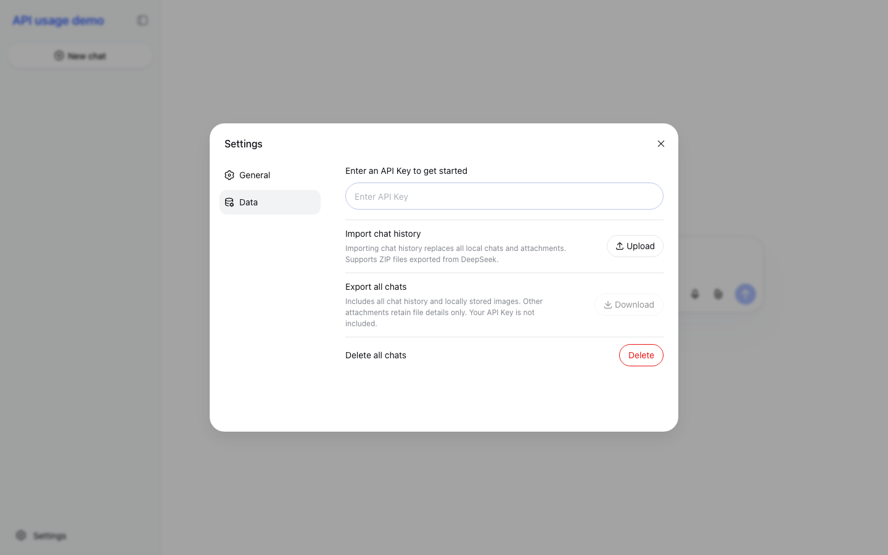
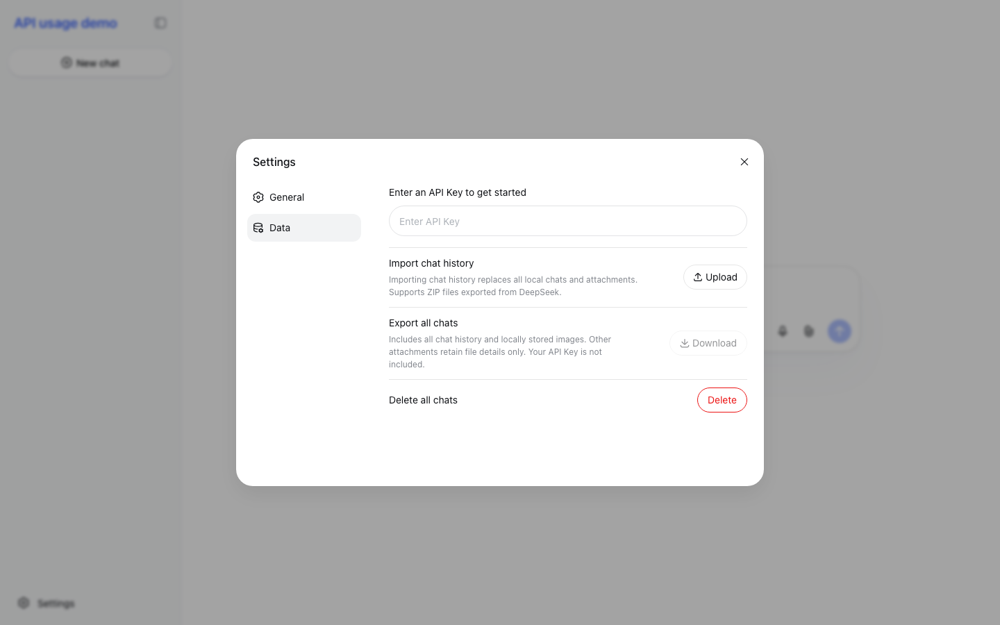

# GitHub 项目 chat-demo 调研报告

- 调研时间：2026-11-14 08:42–08:55（CST，UTC+8）
- 调研范围：GitHub 上名为 `chat-demo` 的项目，先定位具体仓库，再评估可用性
- 方法：抓取仓库元数据与源码、本地构建、无头浏览器渲染、线上实例核对、官方文档比对
- 一句话结论：**你问的应是 DeepSeek 官方的 `deepseek-ai/chat-demo`**——一个 MIT 许可、纯前端静态、浏览器直连 DeepSeek API 的聊天 Demo；开箱即用、适合试用和二次开发，但只适配 DeepSeek 自家协议，不宜直接当生产多用户产品。

---

## 1. 定位：具体是哪个 chat-demo

`chat-demo` 是极常见的仓库名（GitHub 搜索 `chat-demo in:name` 命中 1.4 万个）。按 star 排序的**精确同名**仓库里，主要候选是：

| 仓库 | Star | 语言 | 最近推送 | 许可 | 说明 |
|---|---:|---|---|---|---|
| **deepseek-ai/chat-demo** | **704** | TypeScript | 2026-11-13 | MIT | DeepSeek 官方「Chat Demo」，2026-11-12 新建 |
| musonza/chat-demo | 110 | PHP | 2026-10-23 | 无 | Laravel `musonza/chat` 包的演示应用 |
| yy1193889747/chat-demo | 39 | Java | 2018-02-08 | 无 | 2018 年的 Spring Boot + WebSocket 网页 IM 示例 |
| modularcloud/chat-demo | 7 | TypeScript | 2025-08-12 | 无 | 无描述的早期项目 |

另有名称相近的大仓（不是精确同名）：`anse-app/chatgpt-demo`（7.9k★）、`duytq94/flutter-chat-demo`（1.8k★）、`cloudflare/workers-chat-demo`（1.1k★）。

**判定为 DeepSeek 官方仓库的依据（4 条，非猜测）：**

1. 名称精确等于 `chat-demo`，且 `deepseek-ai` 是 DeepSeek 官方 GitHub 组织；
2. 2026-11-12 创建，与 DeepSeek 2026-11-13 官方公告《The full DeepSeek App experience, now via API》同批发布——公告里直接给出该仓库链接作为「open-source frontend demo」；
3. DeepSeek 官方 API 文档《Build a Chatbot》的 Demo 小节写明：源码 `github.com/deepseek-ai/chat-demo`，在线体验 `cdn.deepseek.com/chat-demo`；
4. 你本机运行的 DeepSeek Harness 用的是 `deepseek-flash` 模型，与该 Demo 默认模型一致，语境吻合。

> 不确定性：如果实际想调研的是别家同名仓库（例如某公司内部项目），给出 star/语言/作者可再核；本报告以下内容均针对 `deepseek-ai/chat-demo`。

---

## 2. 项目是什么

- **定位**：DeepSeek 官方开源的**前端参考实现（Demo）**，用来演示「用 DeepSeek API 复刻一个 DeepSeek App」。它**不是** deepseek.com 网页版的源码，也没有任何服务端代码。
- **架构**：纯静态站点，浏览器直接请求 `https://api.deepseek.com`；API Key、会话、附件全部存在浏览器本地（`localStorage` + `IndexedDB`），无应用后端、无数据库、无账号体系。
- **发布物**：源码（TypeScript + React）+ GitHub Pages 工作流 + Releases 预构建压缩包（v0.1.1，解压即用）。
- **官方定位原话**：文档中标注 *"The demo is for demonstration only."*

仓库快照（2026-11-14 08:46 CST）：704★ / 122 forks / 3 watchers；创建于 2026-11-12T08:08Z；最后推送 2026-11-13T14:33Z；**共 2 个 commit**（`Initial commit` + `fix: clarify history import errors and release v0.1.1`）；**只有 1 位贡献者**（brickmaker）；Issues 已关闭（不能提 issue）、无 PR、无 Discussion/Wiki；仓库体积 123 KB。

---

## 3. 功能清单（README 声明 + 代码核对）

| 模块 | 能力 |
|---|---|
| 会话 | 多会话、自动生成标题、重命名/删除、编辑提问、重新生成、消息分支切换、续写 |
| 输出 | 流式回复、深度思考（thinking 块）、停止生成 |
| 联网 | 智能搜索（`deepseek_web_search`，含边想边搜/图搜）、读链接（`deepseek_read_url`）、正文来源引用角标与来源卡片 |
| 附件 | 上传/粘贴/拖拽，经 Files API 解析 PDF、Office、图片等；非图片附件保留元数据 |
| 语音 | 录音转写（ASR，WAV/Ogg，≤120s/8MiB）、朗读回复（TTS，音色 stella/tide，裸 PCM 24kHz） |
| 渲染 | Markdown、代码高亮（Prism）、KaTeX 公式、Mermaid 图（`securityLevel: strict`） |
| 体验 | 中英双语、明暗/跟随系统主题、移动端布局、位置/语言设置（作为 `latest_reminder` 透传） |
| 数据 | 历史导入导出（ZIP，`export_format_version: 3`）、导入官方 DeepSeek Chat 导出文件、一键删除全部会话 |

**两个容易被忽略的实用点：**

- **可直接导入 DeepSeek App 导出的聊天记录**（v3 ZIP 格式，导入会覆盖本地全部会话，不能合并）；
- **请求强制带 `safety_check.level = "high"`**（代码里写死），符合官方对公开应用的内容安全要求；`title` 仅在会话还没有标题时（通常首轮）开启。

---

## 4. 技术实现与工程质量

- **技术栈**：React 18.3.1 + TypeScript 7.0.2 + Zustand 4.4.7 + rspack 2（SWC 编译、lightningcss）+ CSS Modules；lint 用 oxlint，格式化用 oxfmt；包管理 pnpm。
- **规模**：`src/` 下 155 个文件、**19,151 行**（components 约 1.0 万行、services 约 0.78 万行）。
- **产物**：`dist/` 4.5 MB（主 JS 464 KB、字体 1.1 MB、其余为按需加载 chunk）；Release 压缩包 1.8 MB。
- **浏览器目标**：Chrome/Edge ≥105、Safari ≥16、Firefox ≥110；构建需 Node ≥22.12 + pnpm。
- **CI**：GitHub Actions 全部按 commit SHA 固定 action 版本；Pages 工作流跑 `type` + `lint` + `build` 后发布；CodeQL 检查成功。
- **安全抽查**：Mermaid 用 `securityLevel: 'strict'` 并额外转义 `` 标签；KaTeX/Prism 的 `dangerouslySetInnerHTML` 注入的是库自身产物；**全仓无第三方统计/遥测**——外部请求只有 `api.deepseek.com` 与充值链接 `platform.deepseek.com`。
- **缺失项**：**没有任何测试**（无单测/E2E，`package.json` 无 test 脚本），CI 也只有 type + lint + build；没有 CHANGELOG；`package.json` 未声明 `packageManager`。

---

## 5. 可用性实测（本次真实执行，不是照抄 README）

| # | 检查项 | 方法 | 结果 |
|---|---|---|---|
| 1 | 依赖安装 | `pnpm install --frozen-lockfile`（Node 24.15 / pnpm 11.28.5） | ✅ 26.2s 完成 |
| 2 | 类型检查 | `pnpm type`（tsc） | ✅ 通过，无报错 |
| 3 | Lint | `pnpm lint`（oxlint，118 文件/100 规则） | ✅ 0 warning / 0 error |
| 4 | 生产构建 | `pnpm build`（rspack） | ✅ 2.69s 完成，产出 4.5 MB dist |
| 5 | 产物一致性 | 本地构建 vs v0.1.1 Release | ✅ `index.html` 完全一致，主 JS 哈希同为 `466d2fef…`（SHA-1；Release 可由源码一比一复现） |
| 6 | 离线可用 | 解压 Release 后用 `file://` 打开 | ✅ 正常渲染，首次自动弹设置框要求填 Key |
| 7 | 在线可用 | GitHub Pages 与 `cdn.deepseek.com/chat-demo` | ✅ 均 200，界面与本地一致 |
| 8 | 开发模式 | `pnpm dev` | ✅ 953ms 编译，`localhost:8090` 可访问 |
| 9 | 跨域（CORS） | 带 `Origin: github.io / localhost:8090 / example.com / null` 请求 `api.deepseek.com` | ✅ 服务端**回显任意 Origin**，预检放行 `x-api-key`、`content-type`、`anthropic-beta`——自建静态托管和 `file://` 打开都不会被 CORS 卡住 |
| 10 | CI 状态 | 最近 Pages / CodeQL 运行 | ✅ 全部 success |
| 11 | 遥测排查 | 源码检索 analytics/telemetry/sentry 等 | ✅ 无 |
| 12 | 端到端发消息 | 需真实 DeepSeek API Key | ⏸ 未执行（本机无 DeepSeek Key，模型走本地网关），需你用自己 Key 验证 |

**界面实测**（本机无头 Chromium 渲染；GitHub Pages、CDN、本地 `file://` 三处一致）：首屏为侧边栏 + 设置弹窗（General：API Key；Data：导入/导出/删除），未填 Key 时自动弹出。

| 线上（GitHub Pages） | 离线（Release 解压 + `file://`） |
|---|---|
|  |  |

---

## 6. 怎么用（最短路径）

**A. 在线试（30 秒）**：打开 <https://cdn.deepseek.com/chat-demo> → 设置里填 API Key → 直接聊。
**B. 离线用（不装 Node）**：Releases 下载 `chat-demo-v0.1.1.zip` → 解压 → 双击 `index.html` → 填 Key。静态资源全部本地，断网也能打开界面（聊天仍需联网）。
**C. 自建/二次开发**：
```sh
git clone https://github.com/deepseek-ai/chat-demo.git
cd chat-demo && pnpm install && pnpm dev   # http://localhost:8090
pnpm build                                  # 产物在 dist/，可放任意静态托管
```
**D. 接自建网关/代理**：改 `rspack.config.ts` 里的 `createConfig({ apiOrigin: 'https://your-proxy' })` 后重新构建（**API 地址是构建期常量，运行时不提供修改入口**）。
**E. 迁移历史**：官方 DeepSeek App 导出的 ZIP，在 Settings → Data 导入（会**替换**本地全部会话，且不可回退）。

---

## 7. 成本（用你自己的 Key，按量计费）

Token 费用之外，扩展能力按工具调用另行计费（官方价，2026-11-13 发布，本报告抓取于 2026-11-14，**限时折扣会变**）：

| 工具 | 价格 |
|---|---|
| Search（联网搜索） | $0.75 / 1K 次请求 |
| Fetch（读链接/抓取） | $0.75 / 1K 次请求 |
| OCR（文件解析） | $0.225 / 1K 页 |
| ASR（语音转写） | $0.058 / 小时（5 折，原价 $0.116，限时） |
| TTS（朗读） | $0.225 / 1 万字符（5 折，原价 $0.45，限时） |

个人轻度使用成本很低；但「搜索 + 读多个链接 + 长文档解析」会按次叠加，重度使用前建议先在 `platform.deepseek.com` 设额度提醒。

---

## 8. 限制与风险（评估可用性时最该看的）

1. **协议强绑定 DeepSeek**：走 `/anthropic/v1/messages`（Anthropic 兼容）+ 专有扩展块（`deepseek_web_search`、`deepseek_read_url`、`latest_reminder`、`title`、`safety_check`）、Files API（beta 头 `files-api-2025-04-14`）以及 `/v1/tools/asr|tts`。**不能**直接换 OpenAI 兼容端点或第三方模型，改造量大。
2. **模型写死**：代码里 `const MODEL = 'deepseek-flash'`，界面没有模型选择（类型里预留了 `deepseek-v4-pro` 但未启用）。
3. **API 地址构建期注入**：没有运行时「API Base URL」设置；换代理/网关必须改代码重建。
4. **工程成熟度低**：v0.1.1、2 个 commit、1 位作者、0 测试、Issues 关闭（连 bug 都没地方提）。官方自述「for demonstration only」。不建议作为长期关键依赖，升级/修复不可预期。
5. **安全与隐私**：
   - API Key 明文存 `localStorage`，同源 XSS 或浏览器插件可直接读走；**不要把它部署在不可信的共享域名下**；
   - 公开对外提供服务需自行承担内容安全、模型备案、AI 生成内容标识等合规义务（官方要求公开应用开启 safety check，Demo 已强制开启）；
   - 正文、附件、录音都会发往 DeepSeek；代码注释表明附件上传**不设过期时间**，README 也明说「删除会话不会删除已上传到 API 服务的文件」；
   - 会话只存在本机浏览器，清缓存/换设备即丢，重要记录要手动导出。
6. **文档小瑕疵**：中英文 README 的 Releases 链接仍指向旧仓库名 `deepseek-chat-demo`（GitHub 302 跳转到现名），说明仓库改过名；不影响使用。
7. **无鉴权/无多用户**：没有登录、配额、审计，谁打开页面谁就能用（用自己的 Key）。

---

## 9. 适用性判断

| 场景 | 结论 | 理由 |
|---|---|---|
| 个人/小团队自用聊天前端 | ✅ **推荐** | 零部署、30 秒上手；功能覆盖搜索/文件/语音/导入导出；成本仅 API 用量 |
| 二次开发基座（做自己的 DeepSeek 客户端） | ✅ **推荐** | MIT；官方协议全覆盖、代码结构清晰（19k 行、模块分层合理）、构建 3 秒内；补测试和运行时配置即可 |
| 生产多用户产品 | ❌ **不建议直接用** | 无后端/无鉴权、Key 在前端、无配额与审计；需加服务端代理与密钥托管 |
| 想接非 DeepSeek 模型 | ❌ **不划算** | 协议层需重写，不如换通用客户端（Open WebUI / LobeChat 等） |

**建议**：如果目的是「看看 DeepSeek App 的能力怎么用 API 拼出来」或「拿一个能立刻用的 DeepSeek 聊天界面」，这个仓库是当前最优解（官方、MIT、可复现构建）；如果目的是「自建一个多人可用的聊天服务」，把它当 UI 参考、另加服务端代理更稳妥。

---

## 10. 未验证项与不确定性（如实标注）

- **未用真实 API Key 端到端收发消息**：本机没有 DeepSeek API Key（DeepSeek Harness 走本地网关），避免擅自使用他人凭证/产生费用；A/B/C 三条路径的「填 Key 后能否真实对话」需你自行验证（约 30 秒）。
- 未做移动端真机、Safari/Firefox 实机矩阵，仅桌面 Chromium 无头渲染。
- 未逐行审阅 19k 行，只抽查了 API 客户端、SSE 解析、存储与导入导出、Mermaid/KaTeX 渲染、CI 配置。
- star/fork/价格均为 2026-11-14 08:4x CST 快照，会随时间变化。
- 同名仓库排查基于 GitHub 搜索「按 star 排序前 100 条 + 名称匹配前 25 条」，非全量穷举。

---

## 附录：证据与复现

- 仓库：<https://github.com/deepseek-ai/chat-demo>
- 官方公告（2026-11-13）：<https://api-docs.deepseek.com/news/news261113.md>
- 官方构建指南：<https://api-docs.deepseek.com/guides/build_a_chatbot.md>
- 在线 Demo：<https://cdn.deepseek.com/chat-demo>、<https://deepseek-ai.github.io/chat-demo/>
- Release：v0.1.1（`chat-demo-v0.1.1.zip`，1.8 MB，2026-11-13T14:33Z）
- 本机复现命令：
```sh
git clone --depth 1 https://github.com/deepseek-ai/chat-demo.git
cd chat-demo && pnpm install --frozen-lockfile
pnpm type && pnpm lint && pnpm build
gh release download v0.1.1 -R deepseek-ai/chat-demo --pattern '*.zip'
```
