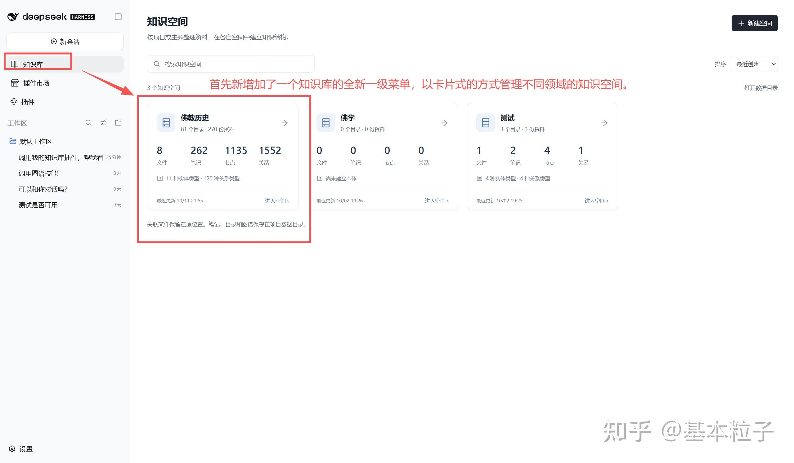
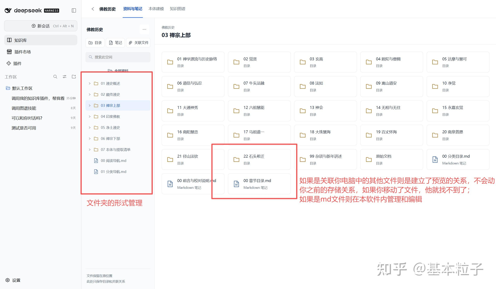
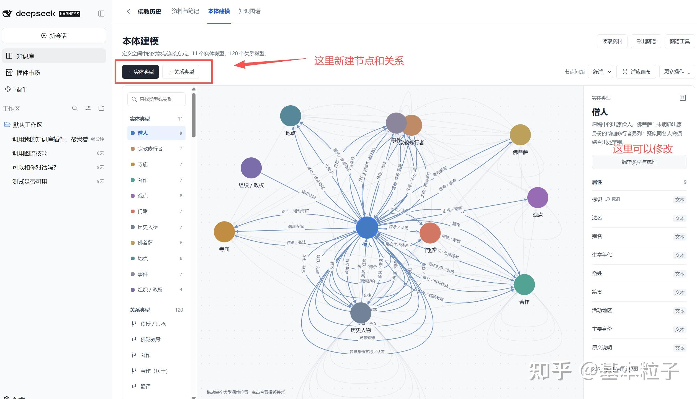
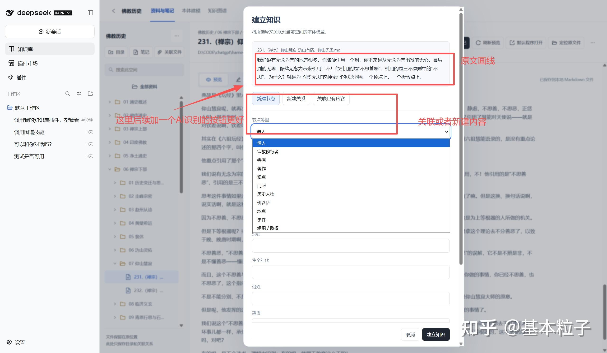
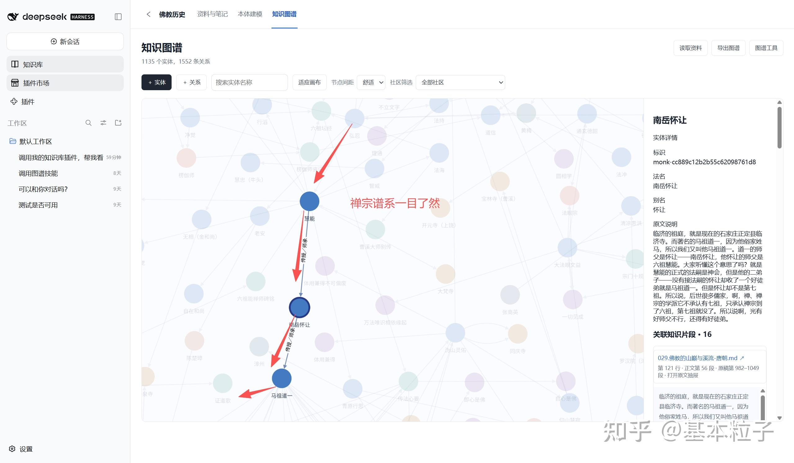
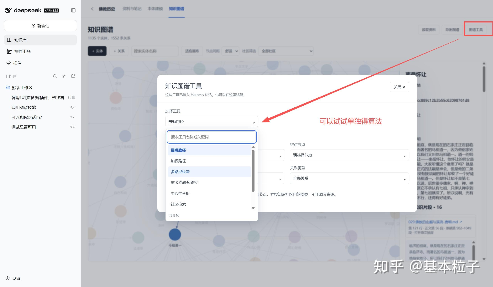
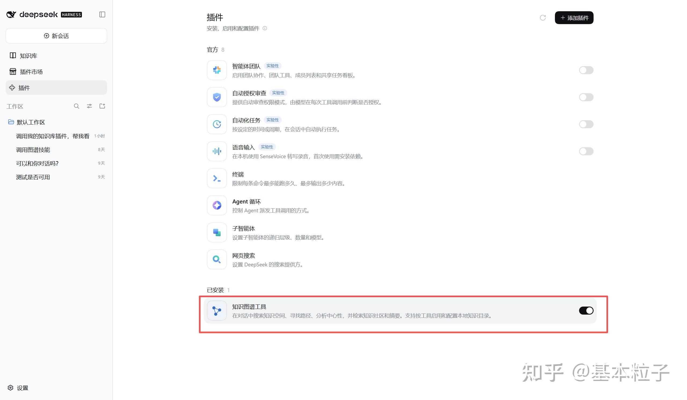
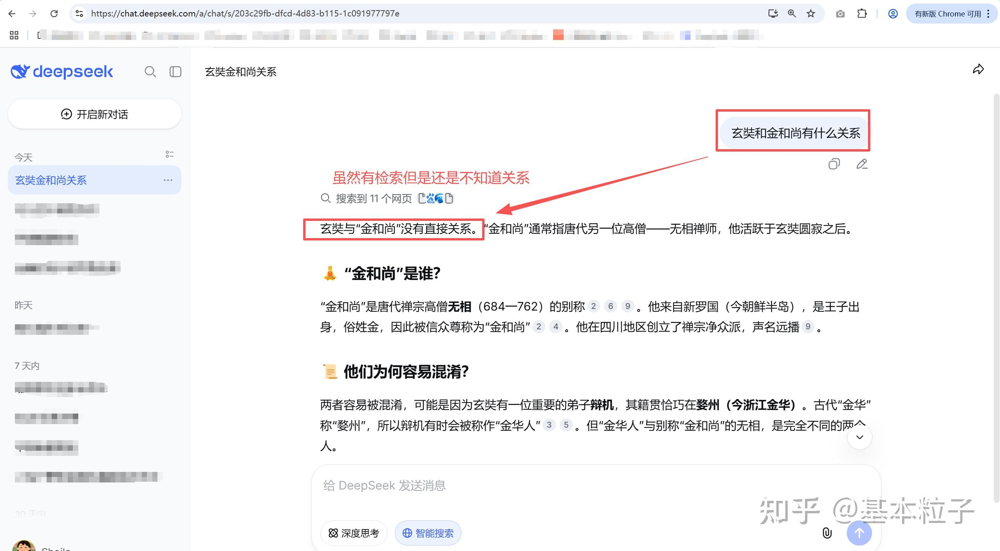
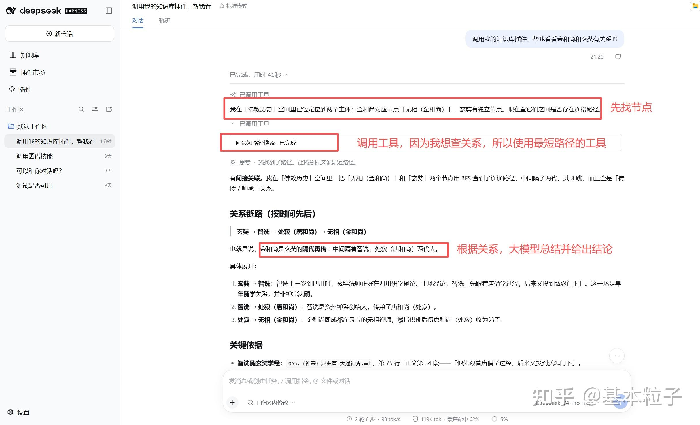
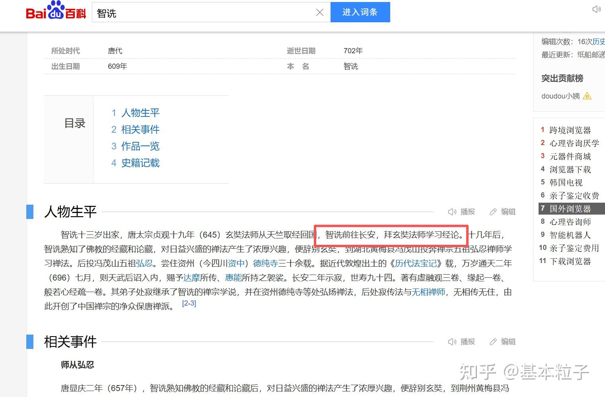

# 给DeepSeek-harness装上知识空间+本体论

> 来源：[给DeepSeek-harness装上知识空间+本体论](https://zhuanlan.zhihu.com/p/2092727841804784619)
>
> 作者：基本粒子（10年+汽车研发及数字化经验，一枚正在进化的AI产品）
> 收录于专栏：NLP成长之路
> 发布：2026-10-11 ｜ 最后编辑：编辑于 2026-10-11 22:53・上海
> 数据：20 人赞同

---

各位兄弟大家好，目前在卷王公司持续工作已经很久没更新了，难得十一有个比较长的假期，可以做点喜欢的东西。刚好十一前看了deepseek-harness的介绍和框架，而熟悉我的兄弟可能知道，几年前我研究过一段时间的知识图谱和知识管理的工作，而这又跟最近，尤其是中国国内最火的本体论相关联，所以利用AI的能力把自己一直想做但是没干成的事情做完了。

简单的说就是传统的AI问答，即使模型很强但是面对专业领域，尤其是个人/公司不想对外披露的知识时，仍然无法做出准确可追溯的回答，而我想把图工具作为一个插件给大模型调用，同时解决我自己的知识管理工作。

我的目标有三个：

1. 构建一个我自己的知识管理工具，目录式的管理我本地文件或者我加工后的知识文件；（之前我一直用有道，现在想构建一个本地的）
2. 这个知识文件可以进行本体建模和实体/关系抽取，形成对应的图谱文件；（图文件的联想和路径是大模型略微欠缺的部分）
3. 可以把这些加工后的知识给大模型用；

## 引子

开始正式介绍之前，我们首先得看看我为什么选择deepseek-harness作为底座。它构建于 **一切皆插件** 的架构之上，由 [Cordis](https://link.zhihu.com/?target=https%3A//github.com/cordiverse/cordis) 驱动，其设计参见论文  *[A Programming Paradigm for Spatiotemporal Composability](https://link.zhihu.com/?target=https%3A//arxiv.org/abs/2608.25512)* 。

文档：[DeepSeek Harness](https://link.zhihu.com/?target=https%3A//deepseek-harness.github.io/deepseek-harness/)

从cordis提到得meta-frame得结构，到一切皆插件就能看出，这是一个架构师喜欢的底座。

再介绍一下我的实践案例：最近两年一直在听吴老师的《佛教历史》，我们把佛教四框架之一的历史，作为本次研究的重点，所有的文档信息和知识产权归吴老师所有哈。

## 构建知识空间

既然是方便我管理本地文件，所以选择封装了一个客户端软件，用eletron+deepseek-harness来处理。

然后在知识空间内，做了对应的知识管理，本体建模和图谱抽取的工作；

## 知识加工

从文档到所谓的本体数据，需要业务专家+知识管理专家，一起来讨论构建对应的本体模型（当然现在更火的说法是FDE）。这里展示了我对佛教历史的理解。

节点的核心类型如下：

| 实体类型 | 主要属性 | 常见关联 |
| --- | --- | --- |
| 僧人 | 法名、别名、生卒年代、籍贯、身份 | 师承、著述、弘扬门派、参与事件 |
| 寺庙 | 名称、所在地、创建年代、功能 | 创建者、所属门派、所在地点 |
| 著作 | 书名、类别、成书年代、语言 | 作者、译者、阐释的观点 |
| 观点 | 名称、内容、表述主体、论述主题 | 提出者、阐释者、所属思想传统 |
| 门派 | 名称、形成时期、主要地域 | 创立者、传承者、分支和教义 |

随着阅读深入，我又补充了历史人物、宗教修行者、佛菩萨、地点、事件和组织／政权等类型。

然后又定义了对应的关系，当然也是AI帮我一起定义。

例如，事件需要连接参与人物和发生地点。记录某次建寺事件时，可以继续整理谁参与了它、它发生在哪里、它与哪座寺庙有关。这样，沿着人物就能找到事件，沿着事件又能找到地点和寺庙。

目前，这个空间已经建立了 11 种实体类型和 120 种关系类型。关系的适用范围也区分了实体身份，例如僧人与在家修行者的师承，可以分别表达。

有了本体模型我们就可以抽取内容了，当然这里最重要的是知识构建好之后我要知道知识的出处在哪里，所以无论是什么样的节点和关系，我都会记录关联关系和定位。可以AI抽取人工校对，也可以人工进行新建，下面贴个图展示人工处理的方式。

知识建立完之后就可以用了，首先当然是随便展示看看；每个节点可以按照社区筛选，也立刻可以看到这些内容关联的知识片段。

## 知识应用案例

图建立起来当前是为了用了，首先常用的图算法工具得支持啊

这次，我将查询能力封装成了独立的 Harness 插件 dsh-knowledge-graph。当前版本为 1.0.3，注册了九个工具，覆盖以下能力：

| 能力 | 可以做什么 |
| --- | --- |
| 空间与知识检索 | 查找空间、节点、属性和已保存知识片段 |
| 最短路径 | 找到两个节点之间跳数最少的一条路线 |
| Dijkstra 加权路径 | 按关系中的非负数值属性寻找最小成本路线 |
| 多路径检索 | 查找限定跳数以内的多条可达路线 |
| 前 K 条最短路径 | 按跳数从少到多比较候选路线 |
| 中心性分析 | 使用度中心性、PageRank、介数和接近中心性分析结构 |
| 社区检索与摘要 | 查找相互连接较紧密的节点群组，返回结构摘要和来源 |

这些工具可以在“知识图谱 → 图谱工具”中直接试算，也已经注册到 Harness 的对话工具体系中。

也封装成插件给dsh调用啦

## 试试效果

周末有空试了下效果，对于比较大众的知识，比如跟禅宗谱系相关的知识；在没有咱们这个知识图谱工具的情况下，大模型回答的也相当好，这是因为这类型的知识被佛教历史爱好者反复研究，网上大量这样的知识。所以我选择了一个小众的知识，以蜀地禅系的知识来给大家展示：众所周知，玄奘法师最早在成都学习摄论师。当时蜀地的智诜法师是先跟随玄奘法师学了唯识，然后才转去禅宗弘忍门下学习。我们来看没有知识空间的加持下，同样模型的不同回答。

首先登场的是deepseek的官方问答。

然后再看咱们插件的回答，通过工具识别到两个人之间的关键节点，并且给出了关键依据，做出了正确的回答。

尽管网上可以很容易看到智诜法师跟玄奘的关系，但是大模型还是识别不到。这是因为智诜的名称根本没出现在问答的上下文内。

如果是我在思考这个问答的时候，我的路径大概会是这样：

- 金和尚是蜀地禅宗，玄奘是唯识，他俩似乎没关系；
- 蜀地禅宗的创始人是智诜
- 智诜跟玄奘学习过一段时间，他俩还是有点关系

可见，跟目前人类的大脑活跃程度相比，目前的AI模型能力还是有些差距，人类的联想能力有点强。

在模型的推理和上下文还有限的今天，知识图谱还是能发挥作用的，尤其是在个人和企业一些私域的能力上，但是他的构建成本实在是太高了。不过反过来说，目前大模型的能力又弥补了这部分构建成本。

以上，感谢：帅哥提供的合理上网工具，感谢deepseek开源大法，感谢gpt模型支持

---

*本文由自动化代理自知乎专栏抓取整理，正文内容与图片版权归原作者「基本粒子」所有。抓取时间：2026-11-06。*
